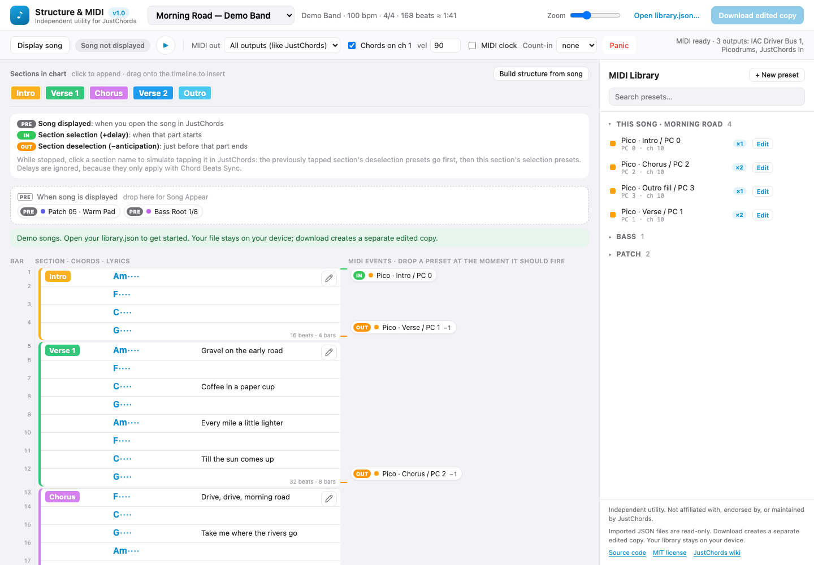

# JustChords Structure & MIDI Editor

**Version 1.0**

> [!WARNING]
> **Experimental utility — validate it on a copy of your library first.** Keep a backup of the original `library.json` and check every edited download before using it with JustChords. Compatibility with all JustChords versions is not guaranteed. The editor never overwrites the source JSON; it only downloads a separate edited copy. This utility is not affiliated with or endorsed by JustChords.
>
> **Utilitaire expérimental : faites d'abord vos essais sur une copie et conservez le JSON original.** Vérifiez le fichier exporté avant utilisation. Le fichier source reste intact ; les modifications sont téléchargées dans une copie séparée. Aucune affiliation avec JustChords.

**[Open the editor](https://deladriere.github.io/justchords-structure-editor/)** · No installation required.

*Screenshot of version 1.0 using the included fictional demo songs.*

An independent browser utility for arranging **JustChords song sections and MIDI events** on a vertical timeline, with chords and full lyrics alongside.

[Source code](https://github.com/deladriere/justchords-structure-editor) · [MIT license](LICENSE)

This is a community utility, **not affiliated with, endorsed by, or maintained by JustChords or its developers**. It complements JustChords; it does not replace the app. The JustChords name identifies the application this utility works with. The MIT license covers this utility's code, not JustChords or your song content.

## What is JustChords?

[JustChords](https://www.justchords.app/) is an application for managing chord charts, lyrics, setlists and live performance workflows on iPhone, iPad and Mac. Its [official wiki](https://wiki.justchords.app/index.php?title=Main_Page) documents the app. Useful references for this utility:

- [Song Structure](https://wiki.justchords.app/index.php?title=Song_Structure): the arrangement of a song's sections.
- [MIDI](https://wiki.justchords.app/index.php?title=MIDI): MIDI presets, Song Appear, section selection and section deselection.
- [Chord Beats](https://wiki.justchords.app/index.php?title=Chord_Beats) and [Chord Beats Sync](https://wiki.justchords.app/index.php?title=Chord_Beats_Sync): chord duration and playback timing.

Those links describe JustChords itself. This utility is an independent implementation and does not promise identical playback or support for every JustChords feature.

## Your original JSON stays unchanged

**The GitHub Pages editor never overwrites your original `library.json`.**

- **Open library.json…** reads the file you choose into browser memory. It does not give the website permission to write back to that file or access iCloud automatically.
- Editing changes the in-memory arrangement only. Your library content is not uploaded to GitHub or another server. The app contains no analytics or third-party scripts; GitHub still serves the website and can log ordinary page requests.
- **Download edited copy** creates a separate file, `library-edited.json`. It does not replace your source file. Reloading the page discards in-memory edits, so download the copy first.
- In the downloaded copy, changed songs' `structure` is replaced, and new or edited MIDI presets are saved in `midiLibraryMessages`. Song text (`rawData`) changes when you use **Edit section**, or when **Build structure from song** needs to number duplicate section labels. `dataVersion` gets a new identifier.
- Other songs, IDs, untouched MIDI presets, unknown fields and other library data are preserved. JSON whitespace/escaping may differ; this is a new file, not a byte-for-byte copy.
- The included demo contains made-up songs and MIDI presets. Personal libraries and backups are not published.

Keep your original as a backup. The downloaded file is a library copy, not a ChordPro song export. Check it before using it with your JustChords installation. The wiki's [song import instructions](https://wiki.justchords.app/index.php?title=Song_Import) do not establish a universal import procedure for raw `library.json` files, so this utility does not claim that such a file can be imported through the normal song-import menu.

## Open directly without a server

Open `index.html` from the project root in Chrome or Edge, then choose your library with **Open library.json…**. Edit the arrangement and use **Download edited copy** to save a separate JSON file. A server is not required for this workflow. With a `file://` URL, loading the demo automatically may be blocked by the browser; opening a JSON file manually still works.

## Use the hosted editor

1. Open the [hosted editor](https://deladriere.github.io/justchords-structure-editor/). No installation or local server is needed.
2. Try the demo or choose your own `library.json` with **Open library.json…**.
3. Select a song. Drag section labels to arrange it, and drag MIDI presets to when they should fire.
4. Use **Download edited copy** to keep your changes in a separate JSON file.

## Features

- Vertical section blocks sized by `{chordbeats}`, with bar numbers, chords and full lyrics.
- The **pencil button** at the top right of each section opens **Edit section** for its text, chords and directives. Paste a `{chordbeats: …}` line after its chords to add timing; the editor shows the beat total and flags mismatches between chord and beat-value counts. The edit applies to every occurrence of that named section in the arrangement and is saved in the downloaded copy. Number duplicate chart labels with **Build structure from song** before editing them.
- Lyric lines aligned with their first chord; blocks expand to avoid overlapping wrapped text. Lines without chords share the preceding lyric/chord anchor rather than inventing timing.
- Drag-and-drop MIDI presets: Song Appear, section start plus delay, or section end minus anticipation.
- **+ New preset** in the MIDI Library creates a named preset containing one or more ordered messages. Add, remove or reorder messages, each with its own channel (1–16). Supports Program Change, Control Change, Note On/Off, Pitch Bend and pressure messages; values use MIDI's 0–127 numbering. For bank/program selection, put CC 0 and/or CC 32 before Program Change.
- **Edit** beside a preset updates its name and messages everywhere it is used. **Save preset** keeps changes in browser memory; **Download edited copy** saves them in a separate JSON library, even if no song arrangement changed.
- **Build structure from song** follows labelled sections in text order and numbers duplicate names.
- Playback at song tempo: chord notes on MIDI channel 1, presets, optional MIDI Clock and a one- or two-bar count-in.
- Click a section while stopped to simulate section selection. Space starts/stops playback; **Panic** sends All Notes Off.

For MIDI output, use a browser with [Web MIDI support](https://developer.mozilla.org/en-US/docs/Web/API/Web_MIDI_API), such as desktop Chrome or Edge, over HTTPS or localhost, and allow MIDI access. Editing and downloading do not require a connected MIDI device. This utility is a MIDI sequencer; it does not include a built-in synthesizer.

## GitHub Pages

The app is a static site: HTML, CSS and JavaScript, with no backend, Node.js runtime or build dependencies. Open `index.html` directly or host the frontend on GitHub Pages. Both use the same import/edit/download workflow.

`.github/workflows/pages.yml` publishes only `index.html`, `app.js`, `styles.css`, `demo-library.json` and `LICENSE`. Personal libraries and backups are excluded from the website artifact. The workflow deploys changes pushed to `main` and can also be run manually. It skips private repositories. In repository Settings → Pages, select **GitHub Actions** as the publishing source.

## Validation and compatibility

Version 1.0 has been checked in desktop Chromium, including section and MIDI preset editing, drag-and-drop, JSON export/reimport, preservation of IDs and unknown fields, desktop/mobile dialogs, and simulated MIDI output.

Physical MIDI hardware and import of exported libraries into JustChords have not been verified for this release. Try the editor with a copy, keep the original JSON, and check the exported copy in your own JustChords version before using it for a performance.

## Preview playback controls

- **Display song** sends the song's Song Appear MIDI presets immediately, as when opening the song in JustChords. It stops any current preview playback and does not start the timeline. Clicking it again resends those presets.
- **Displayed** is a status indicator: the initialization presets have been dispatched in this editor. It does not confirm that hardware received them.
- **Play (▶)** starts the timeline at the song tempo, with section MIDI events, optional chord notes, and optional MIDI Clock/count-in. If the song has not been displayed yet, its Song Appear presets are sent first. The button becomes **Stop (■)** while playing.
- These controls preview MIDI behavior; opening, editing and downloading a library does not require using them or connecting MIDI hardware.

## En français

Utilitaire indépendant pour préparer les structures et événements MIDI de JustChords, avec les accords et les paroles. **Aucune affiliation avec JustChords.** Sur le site GitHub Pages, le fichier JSON original n'est jamais modifié : on ouvre son fichier, on travaille dans le navigateur, puis on télécharge une **copie modifiée**. Aucun contenu de bibliothèque n'est envoyé au serveur et aucune écriture directe dans le JSON d'origine n'est proposée.

## License

[MIT](LICENSE) © 2026 Jean-Luc Deladriere.
